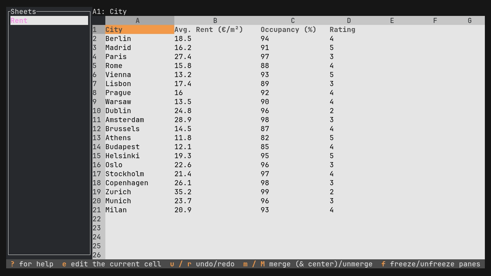
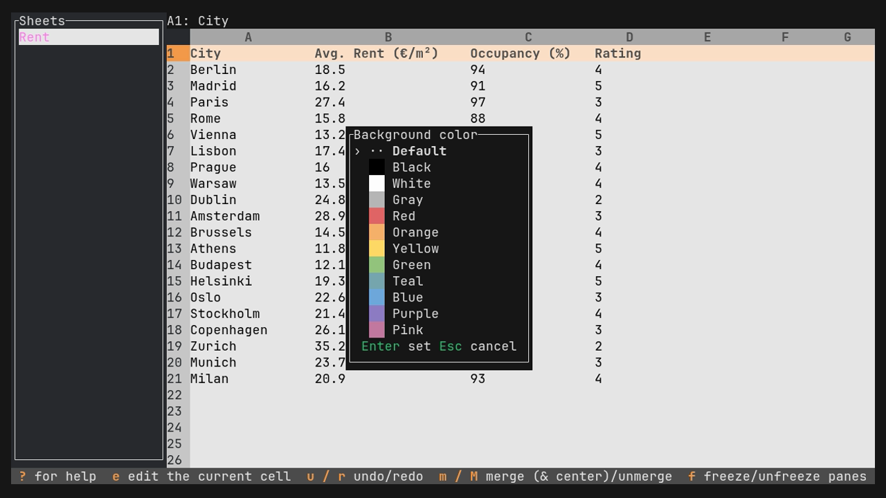
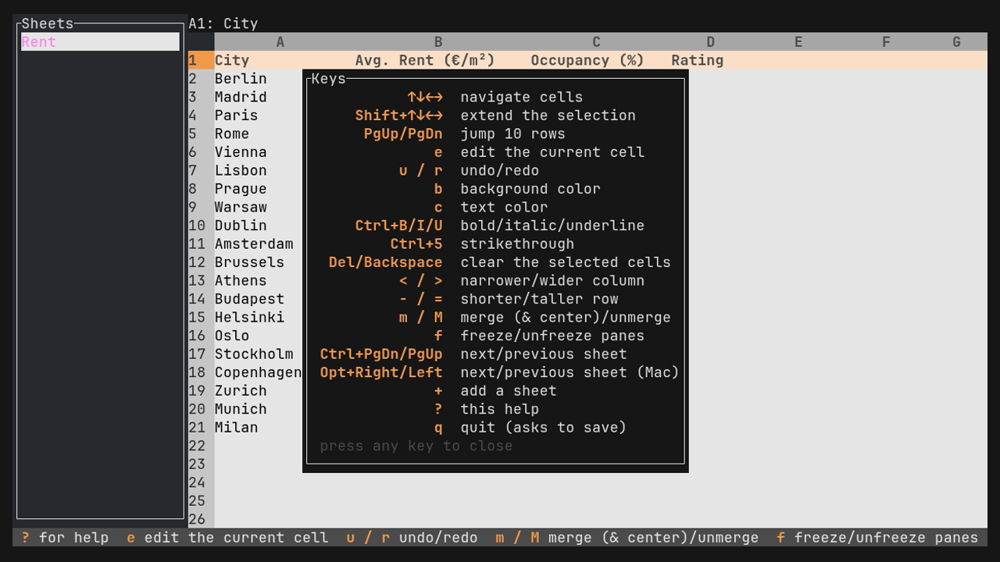
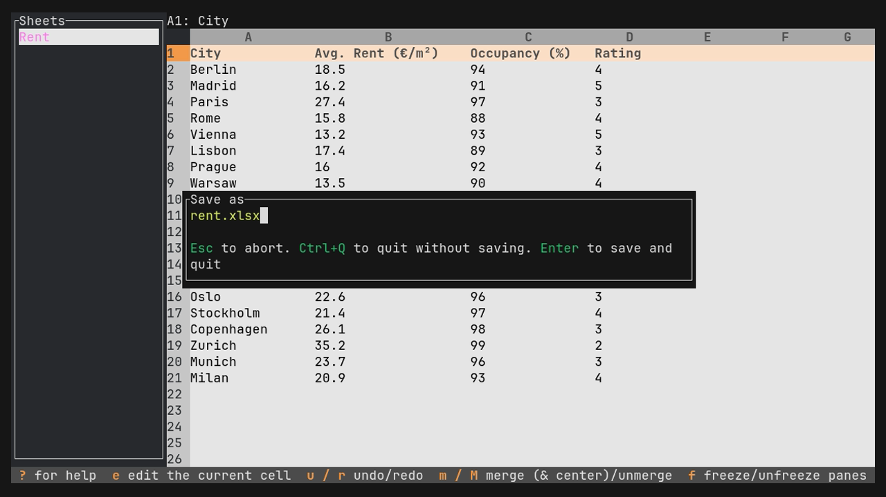

# TironCalc

[![Discord chat][discord-badge]][discord-url]

[discord-badge]: https://img.shields.io/discord/1206947691058171904.svg?logo=discord&style=flat-square
[discord-url]: https://discord.gg/zZYWfh3RHJ

TironCalc, or Tiron for friends, is a TUI (Terminal User Interface) for IronCalc. Based on [ratatui](https://github.com/ratatui-org/ratatui)




## Install

```
cargo install tironcalc
```

## Build from source

```
cargo build --release
```

You will find the binary at `./target/release/tiron`.

## Documentation

Start empty project:

```
$ tiron
```

Load an existing Excel file:

```
$ tiron example.xlsx
```

Keys:

-   `Arrow Keys` to navigate cells (`Shift` + arrows extends the selection)
-   `e` to edit a cell and enter the value or formula.
-   `u`/`r` to undo/redo
-   `q` to quit and save. It asks for confirmation before replacing a file other than the one opened, and before saving a workbook created with another application (IronCalc may not keep all of its features).
-   `+` to add a sheet
-   `Ctrl+PageDown`/`Ctrl+PageUp` to go to the next/previous sheet
    (`Option+Right`/`Option+Left` on a Mac, as in Excel)
-   `b` to pick a background color for the current cell
-   `c` to pick a text color for the current cell
-   `Ctrl+B`/`Ctrl+I`/`Ctrl+U`/`Ctrl+5` to toggle bold/italic/underline/strikethrough
    on the selected cells, as in Excel (`Ctrl+2`/`Ctrl+4` also work for bold/underline)
-   `y`/`x`/`p` to copy/cut/paste, as in vim (`Ctrl+C`/`Ctrl+X`/`Ctrl+V` too).
    Formulas keep their relative references and formatting comes along. A cut
    removes the source when you paste. The text is also sent to the system
    clipboard in terminals that support it (iTerm2, kitty, WezTerm, Alacritty)
-   `Delete` (or `Backspace`) to clear the contents of the selected cells
-   `<`/`>` (or `,`/`.`) to make the current column narrower/wider
-   `-`/`=` to make the current row shorter/taller
-   `m` to merge the selected cells into one (`M` also centers the
    content); on a selection with merged cells it unmerges them
-   `f` to freeze the rows above and the columns to the left of the current
    cell; press it again on the same cell (or on A1) to unfreeze
-   `?` to show the keyboard shortcuts
-   `PgUp/PgDown` to jump 10 rows

| Colors | Keyboard help | Saving |
| --- | --- | --- |
|  |  |  |


## Inspiration

James Gosling of Java fame created [sc](https://en.wikipedia.org/wiki/Sc_(spreadsheet_calculator)) the spreadsheet calculator.

Andrés Martinelli has been maintaining [sc-im](https://github.com/andmarti1424/sc-im), the spreadsheet calculator improvised.

## See also

Other terminal spreadsheets built on the IronCalc engine:

-   [SheetsUI](https://github.com/zaphar/sheetsui)
-   [l123](https://github.com/duane1024/l123)
